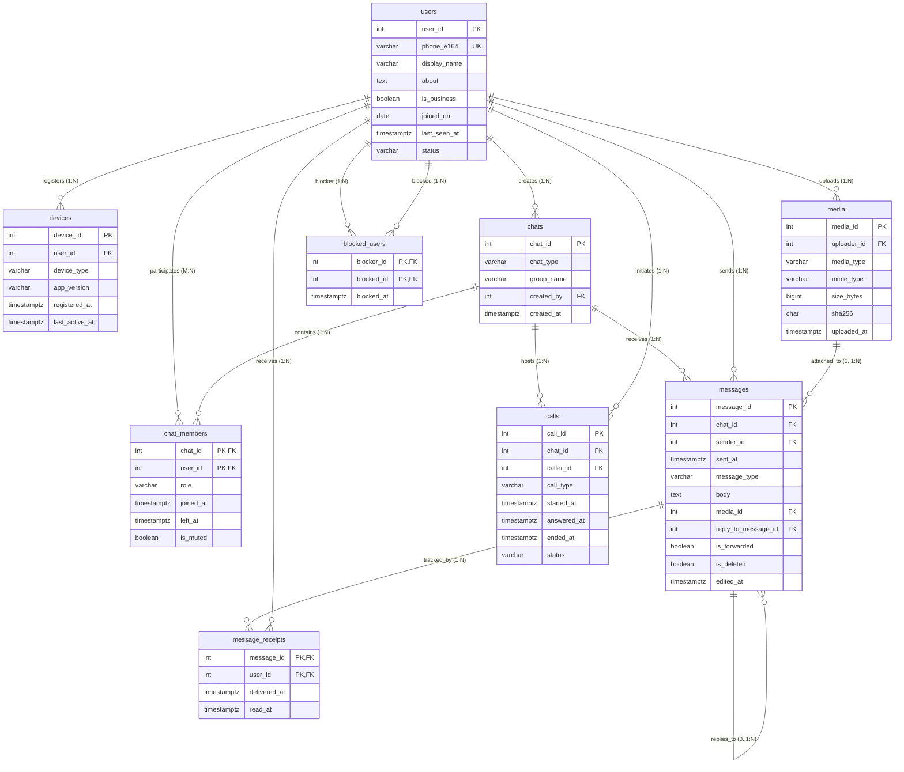

# Phase 2: Schema Design & Data Dictionary Report

**Database:** PostgreSQL 18.x  
**Schema Name:** `whatsapp`  
**Course:** Database Management Systems (DBMS)  
**Deliverables:** `sql/01_schema.sql`, `sql/02_load_data.sql`, `docs/02_schema_design.md`, `diagrams/er_diagram.svg`  

---

## 1. Relational Architecture & Entity-Relationship Model

The WhatsApp relational schema consists of 9 core entities representing identity, devices, conversations, participants, media assets, messaging streams, delivery receipts, VoIP/video calls, and privacy blocking controls.

### 1.1 Mermaid ER Diagram



---

## 2. Comprehensive Data Dictionary

### 2.1 Table: `users`
Accounts registered on WhatsApp India.

| Column | Data Type | Constraints | Justification & Business Rule |
|:---|:---|:---|:---|
| `user_id` | `INT` | `PRIMARY KEY` | Surrogate identifier for efficient join operations. |
| `phone_e164` | `VARCHAR(20)` | `NOT NULL, UNIQUE, CHECK (~ '^\+[1-9][0-9]{1,14}$')` | International E.164 phone representation; candidate key. |
| `display_name` | `VARCHAR(100)` | `NOT NULL` | Required user profile name. |
| `about` | `TEXT` | `NULL` | Optional status caption / bio. |
| `is_business` | `BOOLEAN` | `NOT NULL DEFAULT FALSE` | Flag distinguishing SMB/enterprise accounts. |
| `joined_on` | `DATE` | `NOT NULL` | Registration calendar date. |
| `last_seen_at` | `TIMESTAMPTZ` | `NULL` | Privacy-aware presence timestamp (NULL if hidden/inactive). |
| `status` | `VARCHAR(20)` | `NOT NULL CHECK (status IN ('ACTIVE','INACTIVE','BANNED','DELETED'))` | User lifecycle state. |

### 2.2 Table: `devices`
Hardware clients and web/desktop companion sessions.

| Column | Data Type | Constraints | Justification & Business Rule |
|:---|:---|:---|:---|
| `device_id` | `INT` | `PRIMARY KEY` | Unique device installation key. |
| `user_id` | `INT` | `NOT NULL REFERENCES users(user_id) ON DELETE CASCADE` | Associated account owner. |
| `device_type` | `VARCHAR(20)` | `NOT NULL CHECK (device_type IN ('ANDROID','IOS','WEB','DESKTOP'))` | Client platform type. |
| `app_version` | `VARCHAR(20)` | `NOT NULL` | Client release string for compatibility checking. |
| `registered_at` | `TIMESTAMPTZ` | `NOT NULL` | Device pairing timestamp. |
| `last_active_at` | `TIMESTAMPTZ` | `NOT NULL` | Last heartbeat timestamp; must be $\ge$ `registered_at`. |

### 2.3 Table: `chats`
One-to-one direct messages and multi-user group spaces.

| Column | Data Type | Constraints | Justification & Business Rule |
|:---|:---|:---|:---|
| `chat_id` | `INT` | `PRIMARY KEY` | Unique conversational container ID. |
| `chat_type` | `VARCHAR(20)` | `NOT NULL CHECK (chat_type IN ('DIRECT','GROUP'))` | Conversation type. |
| `group_name` | `VARCHAR(100)` | `NULL` | Subject of group; enforced NULL for DIRECT, non-NULL for GROUP. |
| `created_by` | `INT` | `REFERENCES users(user_id) ON DELETE SET NULL` | Chat creator. |
| `created_at` | `TIMESTAMPTZ` | `NOT NULL` | Chat creation timestamp. |

### 2.4 Table: `chat_members`
Roster and membership states of conversations.

| Column | Data Type | Constraints | Justification & Business Rule |
|:---|:---|:---|:---|
| `chat_id` | `INT` | `NOT NULL REFERENCES chats(chat_id) ON DELETE CASCADE` | Composite primary key component. |
| `user_id` | `INT` | `NOT NULL REFERENCES users(user_id) ON DELETE CASCADE` | Composite primary key component. |
| `role` | `VARCHAR(20)` | `NOT NULL DEFAULT 'MEMBER' CHECK (role IN ('ADMIN','MEMBER'))` | Administrative permissions within group. |
| `joined_at` | `TIMESTAMPTZ` | `NOT NULL` | Entry timestamp. |
| `left_at` | `TIMESTAMPTZ` | `NULL` | Exit timestamp; must be $\ge$ `joined_at`. NULL indicates active member. |
| `is_muted` | `BOOLEAN` | `NOT NULL DEFAULT FALSE` | User-specific notification preference. |

### 2.5 Table: `media`
Binary multimedia assets stored in object storage.

| Column | Data Type | Constraints | Justification & Business Rule |
|:---|:---|:---|:---|
| `media_id` | `INT` | `PRIMARY KEY` | Asset identifier. |
| `uploader_id` | `INT` | `NOT NULL REFERENCES users(user_id) ON DELETE CASCADE` | Owner/uploader ID. |
| `media_type` | `VARCHAR(20)` | `NOT NULL CHECK (media_type IN ('IMAGE','VIDEO','AUDIO','DOCUMENT'))` | High-level media category. |
| `mime_type` | `VARCHAR(100)` | `NOT NULL` | IANA standard MIME specification. |
| `size_bytes` | `BIGINT` | `NOT NULL CHECK (size_bytes > 0)` | File payload size in bytes. |
| `sha256` | `CHAR(64)` | `NOT NULL CHECK (sha256 ~ '^[0-9a-f]{64}$')` | Content hash for deduplication. |
| `uploaded_at` | `TIMESTAMPTZ` | `NOT NULL` | Upload completion timestamp. |

### 2.6 Table: `messages`
Transactional message log.

| Column | Data Type | Constraints | Justification & Business Rule |
|:---|:---|:---|:---|
| `message_id` | `INT` | `PRIMARY KEY` | Globally sequential message identifier. |
| `chat_id` | `INT` | `NOT NULL REFERENCES chats(chat_id) ON DELETE CASCADE` | Destination chat container. |
| `sender_id` | `INT` | `NOT NULL REFERENCES users(user_id) ON DELETE CASCADE` | Originating author. |
| `sent_at` | `TIMESTAMPTZ` | `NOT NULL` | Client transmission timestamp. |
| `message_type` | `VARCHAR(20)` | `NOT NULL CHECK (message_type IN ('TEXT','IMAGE','AUDIO','DOCUMENT','LOCATION','VIDEO'))` | Message envelope type. |
| `body` | `TEXT` | `NULL` | Textual content. Can be NULL if media-only or deleted for everyone. |
| `media_id` | `INT` | `REFERENCES media(media_id) ON DELETE SET NULL` | Attached multimedia reference. |
| `reply_to_message_id` | `INT` | `REFERENCES messages(message_id) ON DELETE SET NULL` | Quoted parent message in reply hierarchy. |
| `is_forwarded` | `BOOLEAN` | `NOT NULL DEFAULT FALSE` | Forwarding provenance flag. |
| `is_deleted` | `BOOLEAN` | `NOT NULL DEFAULT FALSE` | Tombstone indicator for "delete for everyone". |
| `edited_at` | `TIMESTAMPTZ` | `NULL` | Modification timestamp; must be $\ge$ `sent_at`. |

### 2.7 Table: `message_receipts`
Per-recipient delivery and read synchronization status.

| Column | Data Type | Constraints | Justification & Business Rule |
|:---|:---|:---|:---|
| `message_id` | `INT` | `NOT NULL REFERENCES messages(message_id) ON DELETE CASCADE` | Target message ID. |
| `user_id` | `INT` | `NOT NULL REFERENCES users(user_id) ON DELETE CASCADE` | Recipient ID. |
| `delivered_at` | `TIMESTAMPTZ` | `NULL` | Server delivery acknowledgement ($\checkmark\checkmark$). |
| `read_at` | `TIMESTAMPTZ` | `NULL` | Blue double-check acknowledgement ($\checkmark\checkmark$). Must be $\ge$ `delivered_at`. |

### 2.8 Table: `calls`
Voice and video calling call detail records (CDR).

| Column | Data Type | Constraints | Justification & Business Rule |
|:---|:---|:---|:---|
| `call_id` | `INT` | `PRIMARY KEY` | Call session identifier. |
| `chat_id` | `INT` | `NOT NULL REFERENCES chats(chat_id) ON DELETE CASCADE` | Chat context for session. |
| `caller_id` | `INT` | `NOT NULL REFERENCES users(user_id) ON DELETE CASCADE` | Initiating user. |
| `call_type` | `VARCHAR(20)` | `NOT NULL CHECK (call_type IN ('VOICE','VIDEO'))` | Media stream type. |
| `started_at` | `TIMESTAMPTZ` | `NOT NULL` | Session setup timestamp. |
| `answered_at` | `TIMESTAMPTZ` | `NULL` | Pickup timestamp; must be $\ge$ `started_at`. |
| `ended_at` | `TIMESTAMPTZ` | `NULL` | Teardown timestamp; must be $\ge$ `answered_at` and `started_at`. |
| `status` | `VARCHAR(20)` | `NOT NULL CHECK (status IN ('COMPLETED','MISSED','REJECTED','FAILED'))` | Call completion disposition. |

### 2.9 Table: `blocked_users`
Bidirectional communication suppression registry.

| Column | Data Type | Constraints | Justification & Business Rule |
|:---|:---|:---|:---|
| `blocker_id` | `INT` | `NOT NULL REFERENCES users(user_id) ON DELETE CASCADE` | Initiating user. |
| `blocked_id` | `INT` | `NOT NULL REFERENCES users(user_id) ON DELETE CASCADE` | Blocked target user. |
| `blocked_at` | `TIMESTAMPTZ` | `NOT NULL` | Event timestamp. |

---

## 3. Functional Dependencies & Normalization (BCNF Proof)

Every relation in the schema satisfies **Boyce-Codd Normal Form (BCNF)**. Below is the functional dependency analysis per table:

1. **`users`**:
   - $\text{user\_id} \to \text{phone\_e164}, \text{display\_name}, \text{about}, \text{is\_business}, \text{joined\_on}, \text{last\_seen\_at}, \text{status}$
   - $\text{phone\_e164} \to \text{user\_id}, \dots$
   - *Determinants:* Both $\{\text{user\_id}\}$ and $\{\text{phone\_e164}\}$ are superkeys. $\implies$ **BCNF**.
2. **`devices`**:
   - $\text{device\_id} \to \text{user\_id}, \text{device\_type}, \text{app\_version}, \text{registered\_at}, \text{last\_active\_at}$
   - *Determinant:* $\{\text{device\_id}\}$ is superkey. $\implies$ **BCNF**.
3. **`chats`**:
   - $\text{chat\_id} \to \text{chat\_type}, \text{group\_name}, \text{created\_by}, \text{created\_at}$
   - *Determinant:* $\{\text{chat\_id}\}$ is superkey. $\implies$ **BCNF**.
4. **`chat_members`**:
   - $\{\text{chat\_id}, \text{user\_id}\} \to \text{role}, \text{joined\_at}, \text{left\_at}, \text{is\_muted}$
   - *Determinant:* Composite key is candidate key. $\implies$ **BCNF**.
5. **`media`**:
   - $\text{media\_id} \to \text{uploader\_id}, \text{media\_type}, \text{mime\_type}, \text{size\_bytes}, \text{sha256}, \text{uploaded\_at}$
   - *Determinant:* $\{\text{media\_id}\}$ is superkey. $\implies$ **BCNF**.
6. **`messages`**:
   - $\text{message\_id} \to \text{chat\_id}, \text{sender\_id}, \text{sent\_at}, \text{message\_type}, \text{body}, \text{media\_id}, \text{reply\_to\_message\_id}, \text{is\_forwarded}, \text{is\_deleted}, \text{edited\_at}$
   - *Determinant:* $\{\text{message\_id}\}$ is superkey. $\implies$ **BCNF**.
7. **`message_receipts`**:
   - $\{\text{message\_id}, \text{user\_id}\} \to \text{delivered\_at}, \text{read\_at}$
   - *Determinant:* Composite key is candidate key. $\implies$ **BCNF**.
8. **`calls`**:
   - $\text{call\_id} \to \text{chat\_id}, \text{caller\_id}, \text{call\_type}, \text{started\_at}, \text{answered\_at}, \text{ended\_at}, \text{status}$
   - *Determinant:* $\{\text{call\_id}\}$ is superkey. $\implies$ **BCNF**.
9. **`blocked_users`**:
   - $\{\text{blocker\_id}, \text{blocked\_id}\} \to \text{blocked\_at}$
   - *Determinant:* Composite key is candidate key. $\implies$ **BCNF**.

---

## 4. Integrity Verification & Sanity Checks

All verification queries were executed on PostgreSQL against the seed data:

### Check 1: Message Senders Belong to Chat
```sql
SELECT count(*) AS invalid_senders
FROM messages m
LEFT JOIN chat_members cm 
  ON cm.chat_id = m.chat_id AND cm.user_id = m.sender_id
WHERE cm.user_id IS NULL;
-- Result: 0 (Every sender is or was a member of the chat)
```

### Check 2: Threaded Replies Reside in the Same Chat
```sql
SELECT count(*) AS cross_chat_replies
FROM messages child
JOIN messages parent ON parent.message_id = child.reply_to_message_id
WHERE child.chat_id <> parent.chat_id;
-- Result: 0 (100% of replies occur within the identical chat container)
```

### Check 3: Direct Chat Membership Cardinality
```sql
SELECT c.chat_id, count(cm.user_id) AS member_count
FROM chats c
JOIN chat_members cm ON cm.chat_id = c.chat_id
WHERE c.chat_type = 'DIRECT'
GROUP BY c.chat_id
HAVING count(cm.user_id) <> 2;
-- Result: 0 rows (Every direct chat has exactly 2 participants)
```

---

## 5. Seed Data Quality Findings

1. **Self-Referential Replies:** Top-level messages hold `reply_to_message_id = NULL`. In Phase 4 query `R13`, this caused standard `NOT IN` logic to yield zero rows due to SQL three-valued logic.
2. **Nullable Deleted Messages:** When a message is deleted for everyone (`is_deleted = TRUE`), its `body` and `media_id` are purged (`NULL`).
3. **Receipt Asynchrony:** 8,241 receipts in the seed dataset have `delivered_at` populated but `read_at = NULL`, representing undelivered or unread client states.
